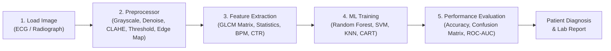

# Complete Compilation and Execution Guide
## Heart Disease Prediction System (Medical Image ML Framework)

This guide provides step-by-step instructions on how to set up the environment, compile, run, and interact with the application both via the **Web Dashboard (One-Frame Interface)** and via the **Command Line Interface (CLI)**.

---

### Table of Contents
1. [System Prerequisites](#1-system-prerequisites)
2. [Quick Start (One-Command Launch)](#2-quick-start-one-command-launch)
3. [Step-by-Step Installation](#3-step-by-step-installation)
4. [Running the Web Application](#4-running-the-web-application)
5. [How to Type and Run Code Inside the Web Application](#5-how-to-type-and-run-code-inside-the-web-application)
6. [Running Individual Pipeline Modules via Command Line](#6-running-individual-pipeline-modules-via-command-line)
7. [The 5-Stage Machine Learning Pipeline](#7-the-5-stage-machine-learning-pipeline)
8. [Project File Architecture](#8-project-file-architecture)
9. [Troubleshooting & FAQ](#9-troubleshooting--faq)

---

### 1. System Prerequisites
- **Python Version**: Python 3.10, 3.11, 3.12, 3.13, or 3.14 (64-bit recommended)
- **Operating System**: Windows 10/11, macOS, or Linux
- **Required Libraries**: Flask, Pillow, NumPy, Scikit-Learn, SciPy, Joblib

---

### 2. Quick Start (One-Command Launch)
Open Windows PowerShell or Command Prompt in the project folder:
```powershell
# Navigate to the folder (if not already there)
cd "c:\Users\keert\OneDrive\Desktop\Heart disease prediction system"

# Run the web application
python app.py
```
Open your browser and visit:
👉 **`http://127.0.0.1:5000`**

---

### 3. Step-by-Step Installation

#### Step 3.1: Install Dependencies
Install all required libraries using `pip`:
```powershell
python -m pip install -r requirements.txt
```
*Note: If you are using Windows, `python -m pip` ensures the command is linked to your active Python runtime.*

#### Step 3.2: Generate Medical Sample Images (Optional)
Pre-render high-resolution ECG traces and cardiac radiographic scans:
```powershell
python generate_sample_images.py
```
This generates 5 clinically distinct samples in `static/samples/`:
- `normal_sinus_rhythm.png` (Healthy Normal Heart)
- `myocardial_infarction.png` (Acute STEMI Infarction)
- `arrhythmia_atrial_fib.png` (Atrial Fibrillation)
- `coronary_artery_disease.png` (Ischemic T-Wave Inversion)
- `cardiomegaly_heart_failure.png` (Enlarged Cardiac Silhouette)

---

### 4. Running the Web Application
Start the Flask web server:
```powershell
python app.py
```
Terminal output:
```text
=================================================================
 HEART DISEASE PREDICTION SYSTEM - WEB APPLICATION
=================================================================
 Server running on http://127.0.0.1:5000
 Open the above URL in your browser to access the application.
=================================================================
```

---

### 5. How to Type and Run Code Inside the Web Application

The web application includes a built-in **Interactive Python Code Studio**:
1. Open the web app at `http://127.0.0.1:5000`.
2. Click on the **`💻 Code Studio & Runner`** tab in the top navigation bar.
3. In the dropdown selector, choose an existing script (e.g. `train_model.py`, `test_predict.py`) or choose **`✏️ Type Custom Code...`**.
4. You can directly edit or type Python code in the code editor.
5. Click the glowing **`▶ Run Code / Compile`** button.
6. The backend executes your code and outputs the results, execution time, and exit status directly in the dark terminal console!

---

### 6. Running Individual Pipeline Modules via Command Line

#### A. Train Machine Learning Models
Train Random Forest, SVM, KNN, Decision Tree, and Logistic Regression:
```powershell
python train_model.py
```
- Trains on 800+ cardiac samples with cross-validation.
- Computes Accuracy, Precision, Recall, F1-Score, Confusion Matrix, and ROC-AUC.
- Saves the trained model to `models/best_heart_model.pkl` and `models/scaler.pkl`.

#### B. Test Image Preprocessing
Run the image loading and filter pipeline:
```powershell
python preprocess.py
```

#### C. Extract Features from an Image
Run GLCM and statistical feature extraction:
```powershell
python feature_extraction.py
```

#### D. Run Complete Diagnosis on an Image via CLI
Run prediction on the default sample or your own custom ECG/cardiac image:
```powershell
# Default sample:
python test_predict.py

# Custom image:
python test_predict.py --image "static/samples/myocardial_infarction.png"
```

---

### 7. The 5-Stage Machine Learning Pipeline



1. **Stage 1: Load Input Image**: Upload any ECG trace or cardiac X-ray, or select from built-in clinical patient cases.
2. **Stage 2: Preprocessor**: Applies grayscale conversion, Gaussian/Median filtering to remove sensor noise, contrast equalization (CLAHE), adaptive thresholding, and Sobel edge detection.
3. **Stage 3: Feature Extraction**: Computes Gray-Level Co-occurrence Matrix (GLCM: Contrast, Dissimilarity, Homogeneity, Energy, Correlation), statistical moments (mean, variance, skewness, kurtosis, entropy), and cardiac waveform features (R-peak count, heart rate BPM, cardiothoracic ratio).
4. **Stage 4: ML Model Training**: Select between **Random Forest**, **SVM**, **KNN**, **Decision Tree**, or **Logistic Regression**, adjust hyperparameters and train live on the dataset.
5. **Stage 5: Evaluation & Diagnosis**: Generates live Accuracy/Precision/Recall/F1 metrics, interactive Confusion Matrix, ROC-AUC curves, and real-time patient diagnosis with circular risk gauge and printable lab report.

---

### 8. Project File Architecture
```text
Heart disease prediction system/
├── app.py                      # Main Flask web application and API controller
├── preprocess.py               # Stage 2: Image preprocessing module
├── feature_extraction.py       # Stage 3: GLCM, statistics & cardiac wave feature extractor
├── train_model.py              # Stage 4: ML model training and evaluation
├── test_predict.py             # CLI test runner for command-line inference
├── generate_sample_images.py   # Synthesizes clinical ECG traces & cardiac images
├── requirements.txt            # Python dependencies
├── RUN_GUIDE.md                # Comprehensive compilation and execution guide
├── README.md                   # Project overview & documentation
├── static/
│   ├── css/
│   │   └── style.css           # Modern cyber-medical glassmorphism design system
│   ├── js/
│   │   └── main.js             # Pipeline sync, SVG visualizer, code runner
│   └── samples/                # Preloaded clinical medical image samples
├── templates/
│   └── index.html              # Unified One-Frame application dashboard
├── models/                     # Serialized trained ML models (.pkl) & JSON evaluations
└── data/                       # Cardiac feature dataset (.csv)
```

---

### 9. Troubleshooting & FAQ

- **Port 5000 is already in use:**
  Run `python app.py` on a different port by editing the last line in `app.py`:
  `app.run(host="127.0.0.1", port=5001)`
- **`pip` command not recognized:**
  Use `python -m pip install -r requirements.txt` instead of `pip`.
- **How to test my own ECG images?**
  Use the drag-and-drop zone in Stage 1 of the web application, or pass `--image "path/to/image.png"` to `test_predict.py`.
